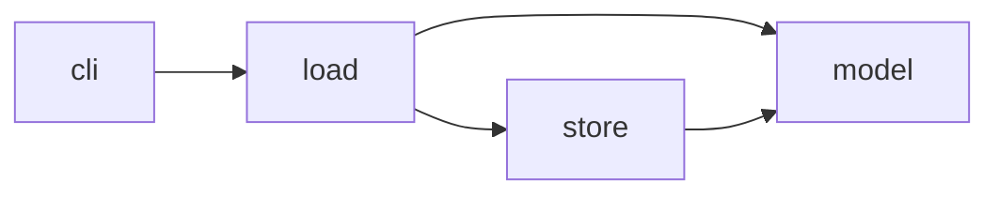

# Architecture

A load reads a consumer's manifests, brings each codebase to its pin in a checkout of the consumer's own, resolves it with its toolchain, and returns one outcome a codebase. Git history is cloned once per URL into a cache every consumer shares, and each checkout stands in the consumer's `.dart_tool/muster/`, since a tool writes into what it tests.

The code is three layers over a pure `model`. Only `store` touches the outside world, so the manifest, every choice a load makes and the stamp are tested with no I/O.

A consumer is the package whose tests or tool load codebases, and its root is the directory a load starts in. A pin is the commit a git codebase stands at, or the version of a hosted one. The cache is the directory of clones every consumer on a machine shares. A clone is the cache's copy of one git URL's history. A checkout is one codebase's files at its pin, under a consumer's root, resolved and handed to a tool. A stamp is the record a checkout carries of what resolved it.

## The load


| Phase | Makes | I/O |
|---|---|---|
| Read | Every codebase from the manifests, each beside the manifest that named it | Yes |
| Survey | Each checkout's stamp, `HEAD`, tracked changes and the toolchain's SDK version | Yes |
| Clone | The clone of the codebase's URL, holding the pin's commit, and whether that commit holds a lock | Yes |
| Choose | Whether the checkout stands, and the lock it resolves to | No |
| Check out | The checkout at its pin, or a hosted package unpacked | Yes |
| Resolve | The toolchain's `pub get --enforce-lockfile` on the lock chosen | Yes |
| Stamp | The stamp that lets the next load hand the checkout out untouched | Yes |

A checkout Choose finds standing from the survey alone is handed out with no Clone. A hosted package skips Clone. The codebases load one after another, and more at once come only with a measurement that earns them.

## Manifest

`muster.yaml` sits at the consumer's root, and `MUSTER_MANIFESTS` names further manifests, a path list in the platform's separator, so a repo's tests reach codebases it cannot name. `Muster.load` takes the same as arguments, and its root, the current directory where it is left out. Wherever its manifests sit, a load's checkouts stand under its root.

```yaml
codebases:
  app:
    git: https://github.com/example/app.git
    commit: <hash>
    root: .
    toolchain: flutter
  analyzer:
    hosted: analyzer
    version: 14.7.0
    resolution: as-dependency
    toolchain: dart
```

| Key | Sets |
|---|---|
| `git`, `commit` | A git codebase: its URL, and the full hash it is pinned at |
| `root` | The package inside a git codebase that resolves and is handed out, `.` where it is left out |
| `hosted`, `version` | A package from pub.dev at its version |
| `resolution` | `alone` or `as-dependency`, `alone` where it is left out |
| `toolchain` | `dart` or `flutter`, the one that resolves it |

A hosted package resolved `alone` takes its dev dependencies among its packages, as its own `pub get` would. One resolved `as-dependency` is the dependency of a package around it, its dev dependencies left out, for a package whose dev dependencies do not resolve.

The rules the manifest obeys:

- A codebase's key is its name, and a name twice across the manifests of one load refuses it.
- A key muster does not know refuses the load before any fetch, named by its path from the top, as `codebases.app.depth` is. So does a value its key cannot take, and a codebase that is neither git nor hosted.
- `parseManifest` is the one place YAML is read. Everything past it takes a `Manifest`.

## Locks

Every codebase resolves to a lock, so its dependencies hold still as pub.dev publishes. Each manifest keeps its locks beside it in `<stem>_locks/`, `muster_locks/` for `muster.yaml`, so no two manifests share a directory.

| Codebase | Resolves to |
|---|---|
| Git, its commit holding `pubspec.lock` in the package `root` names | That lock |
| Git, its commit holding none there | A kept lock |
| Hosted | A kept lock, and a second for an example with a pubspec of its own |

A kept lock is `<name>-<key>.lock`, the key a hash of every manifest value the resolve turns on: the source, the pin, `root`, `resolution` and the toolchain. An example's adds `.example` before `.lock`. So any edit to those values finds no lock and the load returns `Unlocked`, never a resolution on a lock made for other values. `muster lock` resolves each codebase that has none afresh and writes its lock, and removes every lock in the directory that no codebase of its manifest names.

## Store

The cache is `MUSTER_CACHE` where it is set, else `$XDG_CACHE_HOME/muster`, else `~/.cache/muster`, and `%LOCALAPPDATA%\muster` on Windows. It holds one bare clone a git URL, its whole history, named by a hash of the URL. Its fetch carries every branch and tag, `+refs/heads/*:refs/heads/*` and `+refs/tags/*:refs/tags/*`, since a bare clone keeps no refspec of its own, and runs where the clone lacks the pin's commit.

A consumer's checkouts sit under `.dart_tool/muster/` at its root, one directory a codebase by its name:

- A git codebase's checkout is a worktree of its clone, so it shares the clone's objects and carries the whole history, and git keeps its commit from collection. The load prunes the clone's worktrees before it adds one, so a checkout deleted by hand never blocks its own return.
- A hosted package is unpacked by `dart pub unpack`, and pub's own cache holds its archive.

The stamp is a file beside each checkout, written last, naming every manifest value the resolve turns on, the lock's hash, and the SDK version that resolved it. A git checkout stands where its stamp matches, `HEAD` is the pin, and no tracked file has changed. A hosted checkout stands on its stamp alone. What a tool writes beside the tracked files, ignored or untracked, survives a standing checkout, so a tool's own cache inside it lasts across loads.

Any other checkout is made again: a git one by `checkout --force --detach` and `clean -ffdx`, or removed and added afresh where its clone is gone, and a hosted one unpacked afresh.

Deleting `.dart_tool/muster/` or the cache is always safe, and costs one fetch.

## Concurrency

`dart test` runs a package's test files as isolates of one process, and `flutter test` as processes, so a load guards against both. A load takes a lock on each clone and each checkout before it touches them, and holds it until the codebase's stamp is written. The lock is a directory made by an atomic create, naming the process that holds it, and a load takes it over where that process is gone, since a file lock is held by the whole process and shuts out no isolate of it.

A second load waits, then finds the checkout standing and hands it out untouched. A load never moves a standing checkout, so no load resets what another is reading.

A consumer never moves its checkout off the pin or edits a tracked file in it, since another test file may be reading it. One that needs to, such as a replay that resolves older commits one at a time, takes `Muster.scratch`: a worktree of the clone in a temporary directory, its own to move, removed when it is disposed of.

## Outcomes

Every expected failure is a value, so a consumer cannot reach a checkout without handling it. `Muster.load` returns a sealed `Load`:

| Case | Carries |
|---|---|
| `Loaded` | The `Muster`, each codebase's `FetchOutcome` in the manifests' order, keyed by name |
| `Refused` | The manifest and the path of the key that refused it, before any fetch |

`FetchOutcome` is a sealed type:

| Case | Carries |
|---|---|
| `Fetched` | The path of the package to hand a tool, and the SDK version that resolved it |
| `Unlocked` | The kept lock the codebase needs, which `muster lock` writes |
| `CommandFailed` | The command, its exit code and its output |
| `Unstartable` | The executable that could not start, `git`, `dart` or `flutter` |
| `StoreFailed` | The path a file act failed on, and what the system said |

A consumer handles each case by an exhaustive switch, and a test fails on every case but `Fetched`, so no codebase is skipped in silence.

## Layers



| Layer | Holds | Imports |
|---|---|---|
| `cli` | The commands, their flags and the exit codes | `load`, `model` |
| `load` | `Muster.load`, `Muster.scratch` and the lock's write: the phases in order, and the outcomes | `store`, `model` |
| `store` | The cache, the checkouts, the stamps, the load's locks, git and the toolchains | `model` |
| `model` | The manifest and its parse, the codebase types, every choice a phase makes, the stamp's form, the outcomes | Nothing of muster's |

The table is the rule's home, and the rules new code obeys are:

- An import reaches only the layers its row names, so none runs up.
- Only `store` and `cli` import `dart:io`, and only `store` starts a process.
- Every choice a phase makes is a pure function in `model` of what `store` read, so a property test holds it with no checkout.
- A path inside muster is one extension type, made at the seam, never a raw `String`.

Each layer is a directory under `lib/src/`.

## Seams

The outside world reaches muster through two seams, each passed in by constructor:

- Processes, through one runner that git and both toolchains go through, the environment a caller passes added to the process's own.
- Files, through `dart:io` in `store` alone, since git and pub act on real directories whatever muster fakes.

`store`'s tests run on git repos a test makes in a temporary directory, with no network. Hosted packages reach pub.dev, one test a toolchain.

## Output

`muster fetch [manifest...]` loads and prints a row a codebase, its name, its outcome and its path, tab-separated under a header. `muster lock [manifest...]` writes and removes locks and prints a row each. With no manifest named, each reads `muster.yaml` in the current directory and `MUSTER_MANIFESTS`.

The exit codes are one enum in `cli`, and its doc comment is their home.

## Package

muster is one package, its library `lib/muster.dart` exporting `Muster`, `Load`, `FetchOutcome` and their cases, the whole surface a consumer imports. Its dependencies are `path`, `yaml` and `crypto`, which hashes the URL, the lock and a kept lock's key, and `args` for `cli`, so its versions rarely meet a consumer's.
