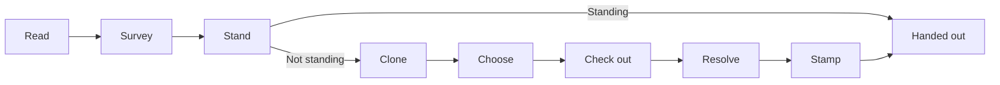
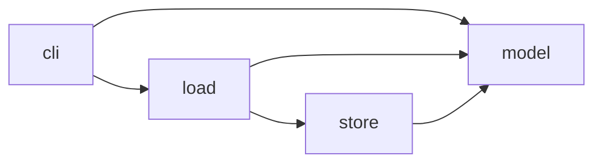

# Architecture

A load reads a consumer's manifests, brings each codebase to its pin in a checkout of the consumer's own, resolves it with its toolchain, and returns one outcome per codebase. Git history is cloned once per URL into a cache every consumer shares, and each checkout stands in the consumer's `.dart_tool/muster/`, since a tool writes into what it tests.

The code is three layers over a pure `model`. Only `store` and `cli` touch the outside world, so the manifest, every choice a load makes and the stamp are tested with no I/O.

A consumer is the package whose tests or tool load codebases. Its root is the directory a load starts in. A pin is the commit a git codebase stands at, or the version of a hosted one. The cache is the directory of clones every consumer on a machine shares. A clone is the cache's copy of one git URL's history. A checkout is one codebase's files at its pin, under a consumer's root, resolved and handed to a tool. A stamp is the record a checkout carries of what resolved it.

## The load

| Phase | Makes | I/O |
|---|---|---|
| Read | Every codebase from the manifests, each beside the manifest that named it | Yes |
| Survey | Each checkout's stamp, whether the package it hands out holds its `pubspec.yaml`, the hash of each package's `pubspec.lock` and `package_config.json` it holds and of each kept lock it could take, `HEAD` and tracked changes from one `git status`, and the toolchain's SDK version, read once per load | Yes |
| Stand | Whether the checkout stands, from the survey alone | No |
| Clone | The clone of the codebase's URL, holding the pin's commit, and which of its packages that commit holds a lock for | Yes |
| Choose | The lock each package resolves to, or `Unlocked` | No |
| Check out | The checkout at its pin, or a hosted package unpacked | Yes |
| Resolve | The toolchain's `pub get --enforce-lockfile --no-example` on each package alone, once every lock chosen is in place | Yes |
| Stamp | The stamp that lets the next load hand the checkout out untouched | Yes |

A hosted package skips Clone, and its Choose follows Check out, since whether it holds an example is read from the package unpacked. The codebases load one after another, and more at once come only with a measurement that earns them.

## Manifest

`muster.yaml` sits at the consumer's root, and `MUSTER_MANIFESTS` names further manifests, a path list in the platform's separator with an empty entry passed over, so a repo's tests reach codebases it cannot name. `Muster.load` takes manifests as arguments in place of both, and its root, the current directory where it is left out. A relative path, a manifest's or the root's, is read against the current directory. Wherever its manifests sit, a load's checkouts stand under its root. The keys a manifest takes are the [README](../README.md)'s.

The rules the manifest obeys:

- A codebase's key is its name, `[a-z][a-z0-9_]*`, since it names a directory, a stamp and a kept lock. A name twice across the manifests of one load refuses it.
- A key muster does not know refuses the load before any fetch, named by its path from the top, as `codebases.app.depth` is, a key that is empty or holds a `.` quoted, as `codebases."a.b"` is. A key of the other kind's is one it does not know. So does a value its key cannot take, a `root` that leaves its repo, and a `git` URL or a `root` holding a line break or another control character but a tab, among them, a codebase that is neither git nor hosted, and one that is both.
- A manifest's file name ends `.yaml`. A manifest named that is missing, unreadable or not YAML refuses the load, and so does a load with no manifest at all.
- `parseManifest` is the one place a manifest's YAML is read, and everything past it takes a `Manifest`. `readPublishedPubspec` reads an unpacked package's pubspec for `resolution: workspace` and `dependency_overrides` alone.
- A directive the YAML reader warns of, one it does not know or a `%YAML` of 1.3 or later, is read past as YAML has it, in a manifest and a pubspec alike, its warning written nowhere.

## Locks

Every codebase resolves to a lock, so its dependencies hold still as pub.dev publishes. Each manifest keeps its locks beside it in `<stem>_locks/`, `muster_locks/` for `muster.yaml`, so no two manifests share a directory.

| Package | Resolves to |
|---|---|
| A git codebase's `root`, or an `example/` in it with a pubspec of its own, where its commit holds a `pubspec.lock` there | That lock |
| The same, where its commit holds none there | A kept lock |
| A hosted package, and its example with a pubspec of its own, but for one left unresolved | A kept lock |

A kept lock is a lock muster keeps beside a manifest. Its file is `<name>-<key>.lock`, and an example's adds `.example` before `.lock`. The key is a hash of every manifest value the resolve turns on: the source, the pin, `root` for a git codebase, `resolution` for a hosted one, and the toolchain. So any edit to those values finds no lock and the load returns `Unlocked`, never a resolution on a lock made for other values.

`muster lock` resolves afresh each package that needs a kept lock and has none, any lock it was served removed first, in its codebase's checkout made again at the pin, its stamp deleted first, and writes its lock to `<file>.partial` beside it before moving it into place, so a write cut short never leaves part of a lock. It leaves every lock that stands, and removes every lock in the directory that no codebase of its manifest names, and every partial none names. A file there whose name ends neither `.lock` nor `.lock.partial` is left.

## Store

The cache, at the directory the [README](../README.md) names, holds one bare clone per git URL, its whole history, named by a hash of the URL as written. Its fetch carries every branch and tag, `+refs/heads/*:refs/heads/*` and `+refs/tags/*:refs/tags/*`, since a bare clone keeps no refspec of its own, and runs where the clone lacks the pin's commit. A new clone is cloned into its temporary clone, `<hash>.partial` beside it, and moved into place, so one that fails leaves nothing in the cache, and git takes its object format from the URL's repo. A clone cut short by its process's end leaves its temporary clone, which no load reads, and each call for a clone removes every temporary clone in the cache whose claim no other hold has, so none outlasts the next but where a process forked meanwhile still carries its claim to its exec. Its fetch prunes each ref the URL no longer has, so a branch deleted there never blocks one named under it. Git reaches a clone by `--git-dir`, since it refuses a bare repo found from a directory where `safe.bareRepository` is `explicit`.

A consumer's checkouts sit under `.dart_tool/muster/` at its root, one directory per codebase by its name:

- A git codebase's checkout is a worktree of its clone, so it shares the clone's objects and carries the whole history, and git keeps its commit from collection. The load prunes the clone's worktrees before it adds one, so a checkout deleted by hand never blocks its own return.
- A hosted package is unpacked by `dart pub unpack` into `<package>-<version>/` in its checkout, and handed out there, and pub's own cache holds its archive. `dart` unpacks it whichever toolchain resolves it, since Flutter's `pub` has no `unpack`. One resolved `as-dependency` sits in a package muster writes around it in the checkout's top, `muster_around`, which depends on it by its path and overrides it to that path, so a dependency of its that depends back on it from its host resolves to it too. Its `Fetched` names the lock and package config of the package around it, the ones its resolve wrote. Its files are the ones pub serves, never pruned, but for a `pubspec.lock` its resolve replaces. muster writes a `pubspec_overrides.yaml` in each package that needs one to resolve alone and holds none: a package resolved `alone` sets no resolution where it is from a pub workspace, `resolution: workspace`, and no dependency overrides where its pubspec holds `dependency_overrides`, as `dart pub unpack` writes for it, and an example overrides the package to its own path, as the package around one resolved `as-dependency` does. pub never serves one at a package's top but may in its example, and one served there stands as served. An example is left unresolved, with no overrides written, where a path dependency of it leaves the package, as a sibling in its publisher's repo that pub does not serve does, read as pub resolves it, so the package is handed out and its stamp names the dependency.

The stamp is a file beside each checkout, `<name>.stamp`, deleted before a make touches the checkout and written last. It names the codebase, every manifest value the resolve turns on among its own, each lock's source and its hash as placed in its package, the hash of each `package_config.json` the resolve wrote, the path dependency that left a hosted example unresolved, and the SDK version that resolved it: the Dart SDK's from `dart --version`, or the Flutter framework's from `flutter --version --machine`. A kept lock is copied into its package as `pubspec.lock` before the resolve, so a git checkout carries it as a file its pin lacks. A checkout stands where the package it hands out holds its `pubspec.yaml`, its stamp matches what the survey read, and each package's lock and `package_config.json` is the one stamped, a kept lock's source beside its manifest too. A git checkout stands as well only where `HEAD` is the pin and no tracked file has changed. What a tool writes beside the tracked files, ignored or untracked, survives a standing checkout, so a tool's own cache inside it lasts across loads.

Any other checkout is made again: a git one by `checkout --force --detach` and `clean -ffdx` where it is a worktree of its URL's clone, or removed and added afresh where it is not or its directory is gone, and a hosted one unpacked afresh. A file standing in a checkout's place reads as no checkout, and is removed as a directory that is no worktree is. A file standing where a directory holding a package's files would stand, the package's own or its `.dart_tool` among them, reads as none of those files. One the pin lacks goes where the checkout is made again, and a pin or a hosted package published with a file named `example` keeps it and holds no example. Git reaches a checkout by `-C` with `--git-dir=.git` and `--work-tree=.`, so a checkout whose `.git` is gone never sends git to a repo around the consumer.

## Concurrency

`dart test` runs a package's test files as isolates of one process, and `flutter test` as processes, so a load guards against both. A claim is a load's hold on one clone or one checkout. A load takes a claim on each before it touches it, and holds it until the codebase's stamp is written. A hosted codebase has no clone, so its load takes its checkout's claim alone and starts no git.

A claim is the kernel's lock on a file beside what it claims, `<name>.claim` beside a checkout and `<hash>.claim` beside a clone, taken through an open of the file that belongs to the load alone. On a POSIX system it is `flock`'s, since `fcntl`'s, the lock `dart:io` takes there, is held by the whole process and shuts out no isolate of it, and on Windows it is `LockFileEx`'s, which `dart:io` takes and which belongs to its handle. A load that finds a claim held tries it again after a pause.

The kernel lets a claim go when its open closes: when the load lets it go, on a POSIX system when a hold the load never let go is collected, when its isolate's group ends, or when its process ends, whether it exits, crashes or is killed. So no claim names its holder, none outlives it, and none is ever taken over, which a holder named by a process id could not hold, since the id can name a live process for a dead claim, after a reboot or where an isolate dies inside a running `dart test`. The file is opened close-on-exec, so a process any isolate starts while it is open carries the claim from its fork to its exec alone, and a claim let go in that window is held until the exec, which a load waiting on it outlasts. The files stay, since a claim deleted while held would let a second load in beside the first.

A load holds a checkout's claim from before its survey until it is handed out, and its clone's from before the clone is touched until the stamp is written, the checkout's always first, so no two loads wait on each other. A scratch takes its clone's claim while it adds its worktree, while a move fetches a commit its clone lacks, and while its disposal prunes the clone's record of it, and `muster lock` takes its claims as a load does. A load removing another clone's temporary clone tries its claim once and passes it by where it is held, so it waits on no claim beyond its own.

A second load waits, then finds the checkout standing and hands it out untouched. A load never moves a standing checkout, so no load resets what another is reading.

A consumer never moves its checkout off the pin or edits a tracked file in it, since another test file may be reading it. One that needs to, such as a replay that resolves older commits one at a time, takes `Muster.scratch`: a worktree of the clone at the pin in a temporary directory, its own to move, removed when it is disposed of. A move takes it to any commit by `checkout --force --detach` and `clean -ffdx`, as a checkout is made again, so it holds that commit's tracked files alone, and resolving it is the consumer's own. A disposal deletes its directory and prunes the clone's worktrees, so the clone keeps no record of it. Its failures are values too, as a load's are.

## Outcomes

Every expected failure is a value, so a consumer cannot reach a checkout without handling it. `Muster.load` returns a sealed `Load`:

| Case | Carries |
|---|---|
| `Loaded` | The `Muster` that makes a scratch of each git codebase the manifests name, and each codebase's `FetchOutcome` in the manifests' order, keyed by name |
| `Refused` | Why the load refused, before any process or file write: a manifest whose file name does not end `.yaml`, one missing, unreadable or not YAML, a key's path in one, a name met twice, no manifest at all, a working directory the system cannot give, no cache, or a system muster takes no claim on |

`FetchOutcome` is a sealed type:

| Case | Carries |
|---|---|
| `Fetched` | The package to hand a tool, its path beside the lock and package config its resolve wrote, its example as an `Example`, and the SDK version that resolved it |
| `Unlocked` | The kept lock the codebase needs, which `muster lock` writes |
| `CommandFailed` | The command, its exit code and its output |
| `Unstartable` | The executable that could not start, `git`, `dart` or `flutter` |
| `StoreFailed` | The path a file act failed on, and what the system said |
| `PinMissing` | The URL, and the pin's commit, on none of its branches or tags after a fetch |

`Example` is a sealed type of its own: `NoExample`, `ExampleResolved` carrying its path, or `ExampleUnresolved` carrying the path dependency that leaves the package. An example that fails to resolve for any other reason fails its codebase.

A consumer handles each case by an exhaustive switch, and a test fails on every case but `Fetched`, so no codebase is skipped in silence.

A scratch's acts return their own outcomes, each failure an `ActFailure`: `CommandFailed`, `Unstartable`, `StoreFailed` or `PinMissing`, as a load meets them.

| Act | Gives | Or |
|---|---|---|
| `muster.scratch(name)` | `Scratched`, carrying the `Scratch` | `NotNamed` where no codebase of the load bears the name, `NotGit` where a hosted one does, or `ScratchFailed`, its directory removed |
| `scratch.move(commit)` | `Moved` | `MoveFailed`, where a commit is on none of its URL's branches or tags after a fetch among them |
| `scratch.dispose()` | `Disposed`, again where it is gone already | `DisposalFailed` |

## Layers

| Layer | Holds | Imports |
|---|---|---|
| `cli` | The commands, their flags, their rows and the exit codes, run by `bin/muster.dart` | `load`, `model` |
| `load` | `Muster.load`, `Muster.scratch` and `muster lock`'s run: Read, each codebase handed to `store` in the manifests' order, the removal of locks no codebase names, and the outcomes | `store`, `model` |
| `store` | The cache, the checkouts, the scratches, the stamps, the claims, git and the toolchains: each checkout's phases from Survey to Stamp in order, and the kept lock's write | `model` |
| `model` | The manifest and its parse, the codebase types, the stamp's form, the outcomes, and every choice a phase makes: Stand's, Choose's, and the act Clone and Check out each take | Nothing of muster's |

The table is the rule's home, and the rules new code obeys are:

- An import reaches only the layers its row names, so none runs up.
- Only `store` and `cli` import `dart:io`, and only `store` imports `dart:ffi` or starts a process.
- Every choice a phase makes is a pure function in `model` of what `store` read, so a property test holds it with no checkout.
- Each kind of path inside muster, a clone's, a checkout's, a manifest's and a lock's among them, is an extension type of its own, made at the seam, never a raw `String`.

Each layer is a directory under `lib/src/`.

## Seams

The outside world reaches muster through three seams:

- Processes, through one runner passed in by constructor, that git and both toolchains go through, each process started with the environment read at the entry and nothing else but the settings below over it. Git starts with none of the variables `git rev-parse --local-env-vars` lists but the two that carry configuration, as git itself does on moving to another repo, so a `GIT_DIR` a hook exports never points it away from muster's repo, and no process asks anything: git's terminal prompt is off unless the environment sets `GIT_TERMINAL_PROMPT`, and every askpass is off whatever the environment or git's configuration names, `GIT_ASKPASS` empty and `SSH_ASKPASS` `false` under `SSH_ASKPASS_REQUIRE=force`, so where git, the ssh it runs or pub's git would ask for credentials, a passphrase or a host's trust it fails instead. OpenSSH heeds `SSH_ASKPASS_REQUIRE` from 8.4, and an older ssh still asks on the terminal where one stands. A user's `core.sshCommand`, agent, credential helper and known hosts still serve, since muster sets no `GIT_SSH_COMMAND`.
- The environment, the system, the working directory and the temporary directory, read from the process once at the public entry and passed down by constructor from there, so a test hands in its own, a cache in its temporary directory among them. The system sets the lock a claim takes and the C library it calls, bound there, and a load on a POSIX system whose C library muster does not know refuses.
- Files, through `dart:io` in `store` alone and never faked, since git and pub act on real directories whatever muster fakes. A claim's lock on a POSIX system goes through the C library's `flock`, its calls handed in by constructor, so a test fails one. A hold never released has its file closed once it is collected by one static native finalizer of the process's `close`, which `_Flock` binds as a static external, the one value and the one binding in `lib/` that outlive a load, since a native finalizer runs only while it is reachable itself and nothing of a load may be.

`store`'s tests run on git repos a test makes in a temporary directory, with no network, and its prompt tests on an `sshd` started as ssh's proxy command and an HTTP server on the loopback. Hosted packages reach a package server on the loopback, named to pub by `PUB_HOSTED_URL` in the environment a test hands in, with pub's cache in its temporary directory, and pub.dev by one test per toolchain. The example's own `dart test`, the README's manifest and test, runs on a copy of the example in a temporary directory with a cache of its own, so it clones equatable from GitHub and unpacks `path` from pub.dev as a stranger's first run does, the one test that clones over the network.

## Output

The rows `muster fetch` and `muster lock` print, and the codes they exit with, are the [README](../README.md)'s.

## Package

muster is one package, its library `lib/muster.dart` the whole surface a consumer imports: `Muster`, `Load`, `FetchOutcome`, the scratch's types and their cases, and every type a public member of theirs names. Each maker whose parameters name a type of muster's own that the surface leaves out, a checkout's paths', a kept lock's, an SDK version read's and a scratch's among them, stays inside the package.
